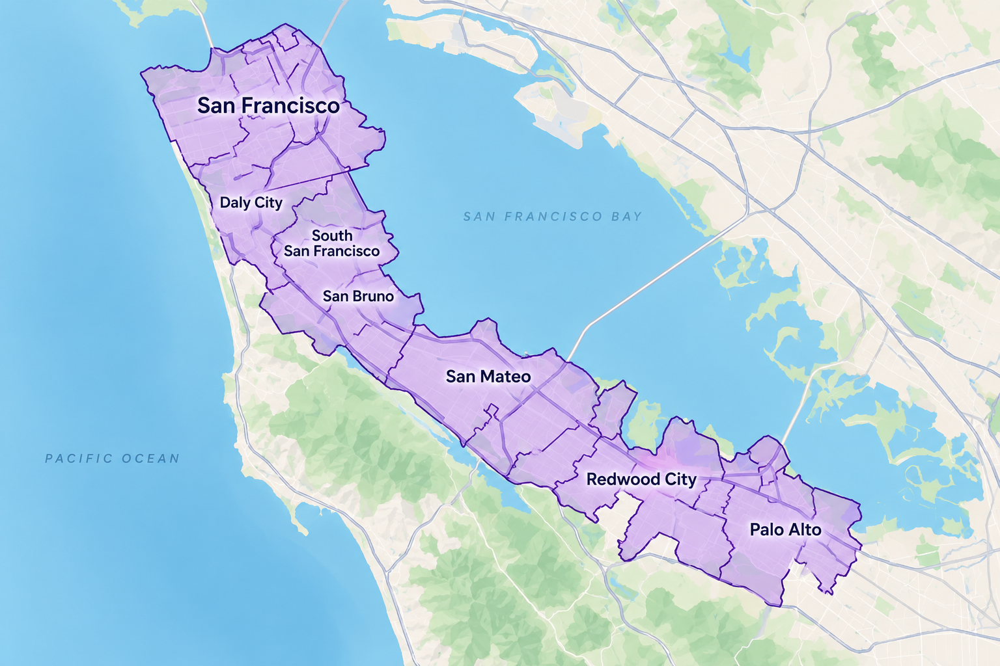

# HomeFlow

**Residential operations management. Make your home work for you.**

HomeFlow is a kitchen organization and setup service on the San Francisco Peninsula, run by Nicholas. Nicholas helps homeowners get their kitchens working: organized cabinets and pantries, the right fixtures and hardware, small repairs, and layout fixes that make daily routines easier.

This repository is the HomeFlow website and booking system. Clients learn what HomeFlow does, book a free consult, book a paid job, and pay online. Nicholas manages clients, estimates and invoices from a private admin area.

> *Your home. In rhythm. By design.*

## What HomeFlow does

Kitchen services:

- **Cabinet & pantry organization:** storage, containers and systems so everything has a place.
- **Fixtures & hardware:** faucets, pulls, handles, lighting and other swap-outs.
- **Small repairs:** hinges, drawers, loose fittings and the fix-it list that keeps growing.
- **Layout & flow fixes:** rework how you move and work in the space.

More rooms are planned after kitchens.

## How it works for a client

1. **Free video consult.** A 30-minute Google Meet call. The client books a time, describes what they want fixed, and can upload photos. Nicholas gives an estimate on the call. No payment.
2. **Book a date.** The client picks a day up to 90 days ahead and pays an $80 deposit through Stripe Checkout. The slot is confirmed once the deposit is paid. The deposit is applied to the final bill.
3. **Nicholas does the work.** Nicholas sends an invoice by email and the client pays online. The invoice total is reduced by the deposit.
4. **Feedback.** After the job, the client can leave feedback and is pointed to HomeFlow's Google and Yelp review pages. No incentives are tied to reviews.

## Pricing and policies

| | |
|---|---|
| Free consult | $0 (30-minute video call) |
| Booking deposit | $80, applied to the final bill |

Pricing is project-based, with no public hourly rates. Nicholas builds a custom estimate for each job from the scope of work and can edit it before sending.

**Cancellation and rescheduling**

- Cancel more than 24 hours before the job: the deposit is fully refunded.
- Cancel within 24 hours: the deposit is kept.
- Reschedule: the deposit carries over to the new time.

The policy is shown at booking, in the confirmation email and on the invoice.

## Service area

San Francisco to Palo Alto: San Francisco, Daly City, Colma, Brisbane, South San Francisco, San Bruno, Millbrae, Burlingame, San Mateo, Belmont, San Carlos, Redwood City, Atherton, Menlo Park, East Palo Alto and Palo Alto.

Job addresses are checked against this list at booking. Anything outside it gets a friendly "outside our area" message.



## The site

**Public pages**

- Landing page: hero, kitchen services, how it works, pricing and cancellation, work showcase, service area, Meet Nicholas, review links and FAQ.
- `/book`: pick a day, pick a 30-minute slot, enter contact details and what needs fixing, optionally add photos.

**Admin area (owner only, behind login)**

- Client registry with visit history and status: lead, consulted, active, completed.
- Stats: free consults done, new clients, jobs completed.
- Estimates: build, edit and send. Accept or decline a job after the consult.
- Invoices: create, email, track paid and unpaid.
- Availability: block off personal time.
- Service area list, rates and policy values editable without code changes.
- Calendar invites sent automatically when a job is scheduled.

## Brand

Black background, white text, gold accent (`#C68B4A`, pending confirmation). Solid colors only, no gradients.
Headlines in Cormorant Garamond, body in Manrope, wordmark in Montserrat.
Photos of Nicholas's work are being collected and will replace the labelled placeholders on the site.

## Tech stack

- [Next.js](https://nextjs.org) (App Router), TypeScript, Tailwind CSS
- [Supabase](https://supabase.com): Postgres, auth, photo storage (schema in `supabase/`)
- [Stripe](https://stripe.com): Checkout for deposits, Invoicing for final bills, refunds
- Google Calendar API: availability, invites and Meet links
- [Resend](https://resend.com): transactional email
- Hosted on [Vercel](https://vercel.com)

## Run locally

```bash
npm install
cp .env.example .env.local   # fill in values; never commit this file
npm run dev
```

Open http://localhost:3000. Other commands: `npm run lint`, `npm run build`.

Database setup: see [`supabase/README.md`](supabase/README.md).

## After the free consult

Nicholas stays in control; the crons only prompt and chase.

1. **Reminders** (`/api/cron/reminders`): client gets a reminder within 24h of the call and a "starting soon" email within 2h. Both include a reschedule link.
2. **Check-in** (`/api/cron/followups`): 30 min after the call is due to end, Nicholas gets an email with three buttons: *We met* (client is emailed the project form + payment info), *No-show* (client is emailed a link to pick a new time), or *We met, don't email*. Each opens a confirm page first, so mail scanners can't trigger it. If Nicholas doesn't answer in 24h he is asked once more.
3. **Clients can self-serve**: every confirmation and reminder links to `/manage/<id>?t=<signed token>` to reschedule or cancel. Rescheduling moves the Google event, restarts reminders, and emails the client and Nicholas. Cancelling emails both and offers a rebooking link.
4. **Chasing**: a client who met Nicholas but sent no project details gets one nudge after 2 days; a no-show who never rebooked gets one nudge after 2 days.
5. Submissions land in `project_requests` and are emailed to `NOTIFY_EMAIL`.

Google Meet attendance can't be detected, which is why Nicholas confirms outcomes himself.

Setup:
- Apply `supabase/migrations/0003_followups_project_requests.sql` and `0004_consult_lifecycle.sql`.
- Set `NEXT_PUBLIC_SITE_URL` (links in emails), `CRON_SECRET` (also signs email links; changing it invalidates old links) and `NOTIFY_EMAIL` (Nicholas's inbox, where the check-in lands).
- Fill in `PAY_ZELLE`, `PAY_VENMO`, `PAY_APPLE_PAY` in `src/lib/content.ts`.
- **Scheduling**: Vercel's free Hobby plan allows daily crons only (`vercel.json` keeps daily runs as a backstop). For timely reminders, `.github/workflows/cron.yml` calls both endpoints every 15 minutes: add repo secrets `SITE_URL` and `CRON_SECRET`. On Vercel Pro you can instead set the `vercel.json` schedules to `*/15 * * * *`. The endpoints are idempotent, so running both is safe.
- Test by hand: `curl -H "Authorization: Bearer $CRON_SECRET" http://localhost:3000/api/cron/followups` (and `/reminders`).
